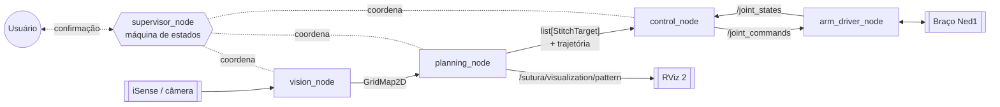
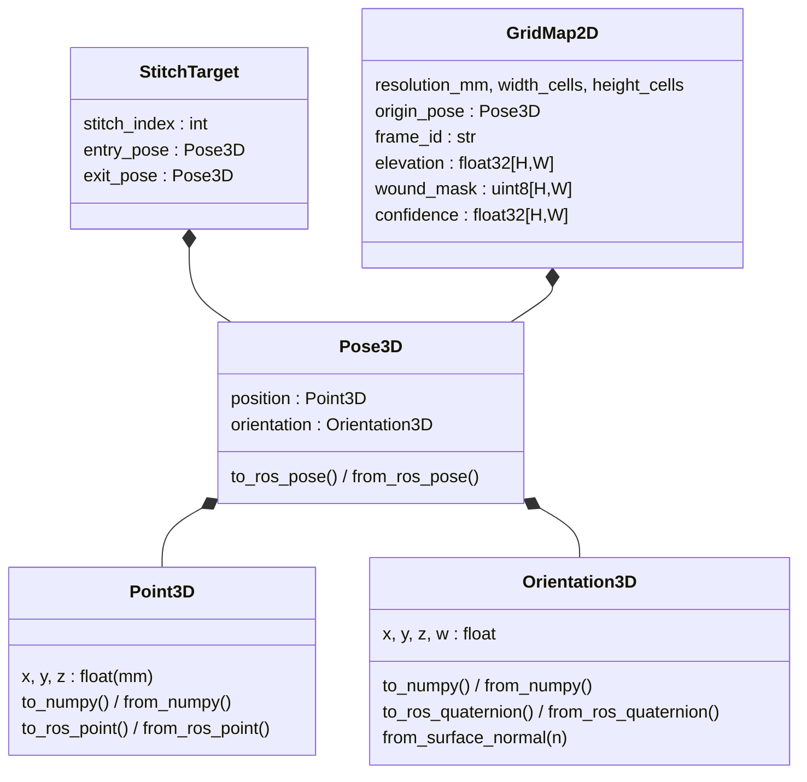
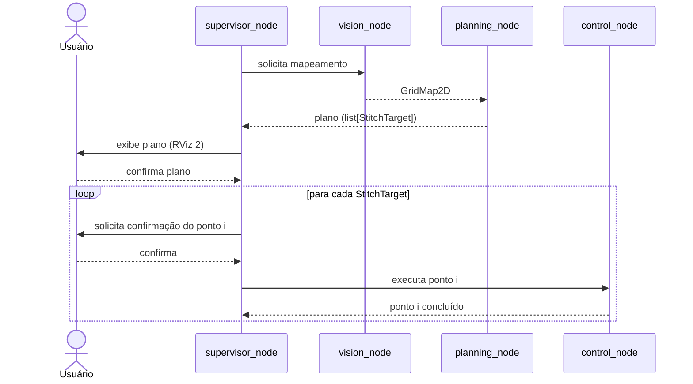

# Arquitetura do SUTURA

> **SUTURA** — Suture Robotisée Autonome à faible coût
> Documento de arquitetura · referente ao commit `4e532aa` (2026-11-03)

Este documento descreve a arquitetura do SUTURA em dois níveis:

- **Implementado**: o que existe hoje no código e como funciona.
- **Planejado**: o que já foi decidido, mas ainda não foi implementado.

Os pontos ainda não definidos aparecem como **a definir** e não foram preenchidos por suposição.

**Convenção de idioma:** a documentação é escrita em português. O código (identificadores, comentários, logs e docstrings) deve ser escrito em inglês.

---

## 1. Visão geral

O SUTURA é um sistema de sutura robotizada autônoma de baixo custo, construído sobre **ROS 2** (pacote Python `ament_python`). O fluxo do sistema é este:

1. Um sensor capta a região da ferida.
2. O sistema gera um mapa 2.5D da superfície.
3. A partir desse mapa, calcula um plano de pontos de sutura.
4. O plano é convertido em trajetórias e em comandos de junta para um braço robótico.
5. Cada etapa crítica é confirmada pelo usuário.

### 1.1 Hardware

| Componente | Situação |
|---|---|
| Braço robótico | **Niryo Ned1** (substitui o MAKIINA, para o qual os drivers atuais foram escritos) |
| Sensor de percepção | **iSense**, a princípio |
| Câmera adicional | Em avaliação (em aberto) |

### 1.2 Pipeline de nós



| Nó | Responsabilidade | Estado |
|---|---|---|
| `vision_node` | Recebe dados do sensor, trata-os e gera o `GridMap2D` | Arquivo vazio |
| `planning_node` | Recebe o `GridMap2D`, gera o plano de sutura (`StitchTarget`) e a trajetória discretizada, e envia ao controle | Parcial: só a geração de padrão linear, com dados simulados |
| `control_node` | Converte a sequência de pontos/tarefas em cinemática para os servos do braço | Arquivo vazio |
| `supervisor_node` | Máquina de estados que coordena o sistema e obtém as confirmações do usuário | Só `# TODO` |
| `arm_driver_node` | Interface ROS ↔ hardware do braço | Implementado para MAKIINA/mock, a ser substituído |

> **Interfaces entre nós: a definir.** A forma de comunicação (tópicos, serviços ou actions), os nomes e os tipos de mensagem entre `vision`, `planning`, `control` e `supervisor` ainda não foram definidos. Os únicos tópicos que existem hoje estão na [seção 5](#5-interfaces-ros-existentes).

---

## 2. Estrutura do repositório

```
SUTURA/
├── README.md
├── LICENSE
└── src/sutura/                        # pacote ROS 2 (ament_python)
    ├── package.xml
    ├── setup.py / setup.cfg
    ├── resource/sutura                 # marcador do ament index
    ├── config/
    │   └── sutura_params.yaml          # constantes de configuração
    ├── sutura/
    │   ├── vision/vision_node.py       # (vazio)
    │   ├── planning/
    │   │   ├── planning_node.py
    │   │   ├── patterns/               # geradores de padrão de sutura
    │   │   │   ├── base_pattern.py
    │   │   │   └── linear_pattern.py
    │   │   └── planners/               # geradores de trajetória
    │   │       └── base_planner.py     # (vazio)
    │   ├── control/control_node.py     # (vazio)
    │   ├── supervisor/supervisor_node.py  # (TODO)
    │   ├── drivers/
    │   │   ├── arm_driver_node.py
    │   │   ├── base_driver.py
    │   │   ├── makiina_driver.py
    │   │   └── mock_driver.py
    │   └── utils/
    │       ├── marker_utils.py
    │       └── data_models/
    │           ├── point_3d.py
    │           ├── orientation_3d.py
    │           ├── pose_3d.py
    │           ├── stitch_target.py
    │           └── grid_map_2d.py
    └── test/
        ├── test_data_models.py
        └── test_pattern_generator.py
```

Executáveis registrados em `setup.py` (`console_scripts`):

| Executável | Ponto de entrada |
|---|---|
| `arm_driver_node` | `sutura.drivers.arm_driver_node:main` |
| `vision_node` | `sutura.vision.vision_node:main` |
| `control_node` | `sutura.control.control_node:main` |
| `planning_node` | `sutura.planning.planning_node:main` |
| `supervisor_node` | `sutura.supervisor.supervisor_node:main` |

Os módulos de `vision_node`, `control_node` e `supervisor_node` ainda não definem `main`, por isso esses executáveis ainda não podem ser executados.

---

## 3. Convenções de unidades e referenciais

| Domínio | Unidade |
|---|---|
| Modelos de dados, mapa e planejamento | **milímetros (mm)** |
| Juntas do braço | **radianos (rad)** |
| Esforço das juntas | N·m (valores simulados hoje) |
| Marcadores RViz 2 | **metros (m)**; a conversão mm → m é feita em `marker_utils.py` |
| Orientações | Quaternion unitário `(x, y, z, w)` |
| Frame padrão | `camera_frame` |

---

## 4. Modelos de dados (`sutura/utils/data_models`)

São dataclasses Python independentes do ROS. Cada uma traz métodos de conversão para as mensagens `geometry_msgs` correspondentes.



### 4.1 `Point3D`, `Orientation3D`, `Pose3D`

- **`Point3D`**: ponto cartesiano em mm. Converte de e para `numpy` e `geometry_msgs/Point`.
- **`Orientation3D`**: quaternion `(x, y, z, w)`, com identidade por padrão. Converte de e para `numpy` e `geometry_msgs/Quaternion`.
  - `from_surface_normal(n)` calcula a rotação que leva o eixo **Z** local ao vetor normal `n`, usando a fórmula de Rodrigues para a matriz de rotação e depois convertendo a matriz em quaternion. Se `n` for nulo ou paralelo a Z, retorna a identidade. Se o traço da matriz for ≤ 0 (rotações próximas de 180°), também retorna a identidade.
- **`Pose3D`**: combina posição e orientação. Converte de e para `geometry_msgs/Pose`.

### 4.2 `StitchTarget`

Representa **um ponto de sutura**:

- `stitch_index`: ordem do ponto no plano, começando em 1.
- `entry_pose`: pose de entrada da agulha.
- `exit_pose`: pose de saída da agulha.

### 4.3 `GridMap2D`: mapa 2.5D

É a representação da superfície do tecido e da ferida. Trata-se de uma grade regular de `height_cells × width_cells` células, cada uma com lado de `resolution_mm`.

| Camada | Tipo | Valor inicial | Significado |
|---|---|---|---|
| `elevation` | `float32` | 0 | Altura Z do tecido em mm |
| `wound_mask` | `uint8` | 0 | 1 = célula pertence à ferida (ROI) |
| `confidence` | `float32` | 1 | Confiança da medição (ainda não usada pelo planejamento) |

**Conversões de coordenadas.** Hoje só a posição de `origin_pose` é usada; a orientação da origem é ignorada.

- `world_to_grid(x, y)`: `col = int((x − x₀)/res)` e `row = int((y − y₀)/res)`. Retorna `None` fora dos limites.
- `grid_to_world(row, col)`: retorna o **centro** da célula, `(x₀ + (col+0.5)·res, y₀ + (row+0.5)·res, elevation)`.
- `get_elevation_at_world(x, y)` e `is_wound_at_world(x, y)`: consultas por coordenada de mundo.

**Normal da superfície.** `compute_surface_normal(row, col)` estima as derivadas `∂z/∂x` e `∂z/∂y` por diferenças centrais, que viram diferenças unilaterais nas bordas. O vetor normal é `(−∂z/∂x, −∂z/∂y, 1)`, convertido em `Orientation3D` via `from_surface_normal`.

**Eixos:** `x` corresponde às colunas e `y` às linhas.

---

## 5. Interfaces ROS existentes

| Tópico | Tipo | Publicador | Assinante | Observação |
|---|---|---|---|---|
| `/joint_commands` | `std_msgs/Float32MultiArray` | — (futuro `control_node`) | `arm_driver_node` | Posições alvo em rad, 6 valores |
| `/joint_states` | `sensor_msgs/JointState` | `arm_driver_node` | — | 10 Hz; nomes `joint_1`…`joint_6`; `position` e `effort` |
| `/sutura/hardware_status` | `std_msgs/String` | `arm_driver_node` | — | Publica `"READY"` após conectar |
| `/sutura/visualization/pattern` | `visualization_msgs/MarkerArray` | `planning_node` | RViz 2 | QoS: `RELIABLE`, `TRANSIENT_LOCAL`, depth 1 |

---

## 6. Módulos

### 6.1 `vision_node` (planejado)

- **Entrada:** dados do sensor (iSense; câmera adicional em avaliação).
- **Processamento:** tratamento dos dados brutos.
- **Saída:** um `GridMap2D` preenchido (elevação, máscara da ferida e confiança) para o `planning_node`.
- **A definir:** algoritmo de segmentação da ferida, calibração do sensor, transformação entre os referenciais do sensor e do braço, e a mensagem/tópico usado para transportar o `GridMap2D`.

### 6.2 `planning_node`

O planejamento tem duas camadas separadas:

| Camada | Pasta | Função |
|---|---|---|
| **Pattern** | `planning/patterns/` | Gera o **padrão de sutura** (onde ficam os pontos), seguindo os padrões usados na medicina. Saída: `list[StitchTarget]`. |
| **Planner** | `planning/planners/` | Gera a **trajetória discretizada** da agulha para executar cada ponto com precisão. Saída: entregue ao `control_node`. |

#### 6.2.1 Interface `BasePatternGenerator` (implementado)

Classe abstrata com um único método:

```python
generate_pattern(grid_map: GridMap2D, margin_mm=3.0, spacing_mm=5.0, entry_offset_mm=4.0) -> list[StitchTarget]
```

#### 6.2.2 `LinearPatternGenerator` (implementado)

Gera pontos equidistantes ao longo do eixo principal da ferida. Os parâmetros são recebidos no construtor:

| Parâmetro | Padrão | Significado |
|---|---|---|
| `margin_mm` | 3.0 | Distância das extremidades da ferida ao primeiro e ao último ponto |
| `spacing_mm` | 5.0 | Distância entre pontos consecutivos |
| `entry_offset_mm` | 4.0 | Distância lateral da linha central até a entrada e a saída |
| `entry_angle_deg` | 90.0 | Armazenado, mas **ainda não usado** no cálculo |

**Algoritmo:**

1. **Extração da ROI:** coleta todas as células com `wound_mask == 1`. Se houver menos de 2, retorna uma lista vazia.
2. **Conversão para mundo:** converte cada célula para o seu centro `(x, y)` em mm.
3. **Linha central por PCA 2D:** o autovetor de maior autovalor da matriz de covariância dá a direção `u` da ferida. As projeções extremas dos pontos sobre `u` definem `start` e `end`.
4. **Distribuição dos pontos:** com `L = |end − start|`, o comprimento útil é `L − 2·margin`. Se ele for ≤ 0, retorna lista vazia. O número de pontos é `⌊útil / spacing⌋ + 1`, e cada centro fica em `start + u·(margin + i·spacing)`.
5. **Geometria de cada ponto:**
   - calcula a normal da superfície `n` na célula do centro;
   - calcula o vetor lateral `v = normalize(u₃ᴅ × n)`, perpendicular à ferida e à normal;
   - define a entrada como `centro + v·offset` e a saída como `centro − v·offset` (apenas em XY);
   - lê o Z da entrada e da saída na camada `elevation`;
   - atribui às duas poses a orientação da **normal no centro**.
6. Pontos cujo centro, entrada ou saída caiam fora do mapa são descartados.

```
            entrada (vermelho)
                 ●
                 │  entry_offset_mm
   start ────────┼────────┼────────┼──────── end      ← linha central (PCA)
       margin    │ spacing│
                 │
                 ●
            saída (verde)
```

#### 6.2.3 Planners (planejado)

- `planners/base_planner.py` existe, mas está vazio.
- O YAML prevê os tipos `analytical`, `moveit` e `mock`, além de `max_cartesian_step_mm` (1.0) e `needle_radius_mm` (12.0).
- **A definir:** a interface do planner e o formato da trajetória entregue ao controle.

#### 6.2.4 Funcionamento atual do nó

Hoje o `planning_node` roda em **modo de teste/visualização**:

1. No construtor, lê `pattern.margin_mm`, `pattern.spacing_mm`, `pattern.entry_offset_mm` e `pattern.default_entry_angle_deg`, e instancia sempre o `LinearPatternGenerator`. O parâmetro `pattern.type` é declarado, mas não é usado.
2. A cada **2 s**, um timer cria um `GridMap2D` simulado (100×100 células, 0.5 mm, superfície plana) com uma ferida retangular em `wound_mask[45:55, 20:80]` (aproximadamente 30 mm × 5 mm).
3. Chama `process_grid_map()`, que gera os `StitchTarget`, converte-os em `MarkerArray` e publica em `/sutura/visualization/pattern`.

Ainda não há assinatura do `GridMap2D` vindo da visão nem envio do plano ao controle.

#### 6.2.5 Visualização (`utils/marker_utils.py`)

`stitch_targets_to_marker_array()` gera 3 marcadores por ponto, com IDs `3i+1`, `3i+2` e `3i+3`:

| Namespace | Tipo | Cor | Tamanho |
|---|---|---|---|
| `stitch_entry_points` | `SPHERE` | Vermelho | Ø 2 mm |
| `stitch_exit_points` | `SPHERE` | Verde | Ø 2 mm |
| `stitch_lines` | `LINE_STRIP` (entrada → saída) | Amarelo | 0.5 mm |

### 6.3 `control_node` (planejado)

- **Entrada:** a sequência de pontos/tarefas, ou a trajetória discretizada vinda do planejamento.
- **Função:** transformar essa sequência em cinemática para os servos do braço.
- **Saída:** comandos de junta para o driver. Hoje o driver escuta `/joint_commands` em rad.
- **A definir:** método de cinemática inversa, malha de controle e uso do feedback de `/joint_states`.

### 6.4 `supervisor_node` (planejado)

É uma **máquina de estados** que coordena o sistema e envolve o usuário nas decisões. Requisitos definidos:

- O **plano de sutura** completo deve ser **visualizado e confirmado** pelo usuário antes da execução.
- **Cada ponto de sutura** deve ser confirmado pelo usuário antes de ser executado.



> Este diagrama mostra apenas os requisitos de confirmação descritos acima. **A definir:** os estados e as transições da máquina, o tratamento de recusa ou cancelamento pelo usuário, o tratamento de falhas, a interface de confirmação e os mecanismos ROS usados.

### 6.5 Camada de drivers (`sutura/drivers`)

#### 6.5.1 Interface `BaseArmDriver` (implementado)

Este é o contrato que todo driver de braço deve implementar:

| Método | Retorno | Descrição |
|---|---|---|
| `connect()` | `bool` | Inicializa a comunicação e prepara o braço |
| `disconnect()` | `None` | Encerra a comunicação e desativa as juntas com segurança |
| `set_joint_positions(angles)` | `bool` | Envia posições alvo em rad |
| `get_joint_positions()` | `list[float]` | Posições atuais em rad |
| `get_joint_torques()` | `list[float]` | Torques das juntas, para detectar força no pad |
| `emergency_stop()` | `None` | Parada imediata |

#### 6.5.2 Implementações atuais

- **`MakiinaArmDriver`**: escrito para o braço MAKIINA via CAN (`can0`). Hoje só **simula**: imprime as mensagens de CAN, guarda as posições comandadas e retorna torques fixos.
- **`MockArmDriver`**: simulação silenciosa. Copia os comandos para o estado e retorna torques de 0.1. O `emergency_stop` mantém a posição atual.

> **Planejado:** como o braço passou a ser o **Ned1**, os drivers serão substituídos. A interface `BaseArmDriver` permite trocar a implementação sem alterar os demais nós.

#### 6.5.3 `arm_driver_node`

- **Parâmetros:** `arm_type` (`makiina` | `mock`, padrão `makiina`) e `can_interface` (padrão `can0`).
- Instancia o driver, chama `connect()` e publica `"READY"` em `/sutura/hardware_status`.
- Assina `/joint_commands` e repassa os comandos para `driver.set_joint_positions()`.
- A cada 0.1 s (10 Hz), publica `/joint_states` com posições e esforços.
- Em `destroy_node()`, chama `driver.disconnect()`.
- `emergency_stop()` ainda não é exposto via ROS.

---

## 7. Configuração (`config/sutura_params.yaml`)

O YAML concentra as constantes úteis do código. A chave `/**` aplica os parâmetros a qualquer nó.

| Parâmetro | Valor | Usado hoje por |
|---|---|---|
| `grid_map.resolution_mm` | 0.5 | — |
| `grid_map.width_cells` | 200 | — |
| `grid_map.height_cells` | 200 | — |
| `grid_map.default_frame_id` | `camera_frame` | — |
| `pattern.type` | `linear` (opções: `linear`, `mock`) | Declarado no `planning_node`, mas não aplicado |
| `pattern.margin_mm` | 3.0 | `planning_node` |
| `pattern.spacing_mm` | 5.0 | `planning_node` |
| `pattern.entry_offset_mm` | 4.0 | `planning_node` |
| `pattern.default_entry_angle_deg` | 90.0 | `planning_node` (armazenado, sem efeito) |
| `planner.type` | `analytical` (opções: `analytical`, `moveit`, `mock`) | — |
| `planner.max_cartesian_step_mm` | 1.0 | — |
| `planner.needle_radius_mm` | 12.0 | — |

Os parâmetros do driver (`arm_type`, `can_interface`) não estão no YAML.

Ainda não existe launch file. O `setup.py` instala `launch/*.launch.py`, mas a pasta não existe. Por isso, para usar o YAML é preciso passá-lo manualmente:

```bash
ros2 run sutura planning_node --ros-args --params-file src/sutura/config/sutura_params.yaml
```

---

## 8. Build, execução e testes

```bash
# no workspace (pasta que contém src/)
colcon build --packages-select sutura
source install/setup.bash

ros2 run sutura planning_node --ros-args --params-file src/sutura/config/sutura_params.yaml
ros2 run sutura arm_driver_node --ros-args -p arm_type:=mock
rviz2   # Fixed Frame: camera_frame · adicionar MarkerArray em /sutura/visualization/pattern
```

Os testes (pytest) ficam em `src/sutura/test/`:

| Arquivo | Cobre |
|---|---|
| `test_data_models.py` | Conversões `Point3D`, `Orientation3D` e `Pose3D` ↔ numpy/ROS; `StitchTarget`; precisão mundo ↔ grade (erro ≤ meia célula); normal de um plano inclinado a 45° (≈ (−0.707, 0, 0.707)); ROI e elevação |
| `test_pattern_generator.py` | Padrão linear sobre uma ferida ao longo de X: gera pontos, o índice começa em 1 e a distância entre entrada e saída é ≈ 8 mm (2 × `entry_offset_mm`) |

```bash
colcon test --packages-select sutura && colcon test-result --verbose
```

Os testes importam `geometry_msgs`, então precisam de um ambiente ROS 2 carregado.

**Dependências declaradas** em `package.xml`: `rclpy`, `std_msgs`, `geometry_msgs`, `sensor_msgs`. **Usadas no código, mas não declaradas:** `visualization_msgs`, `builtin_interfaces` e `numpy`.

---

## 9. Pendências conhecidas no código atual

| # | Local | Pendência |
|---|---|---|
| 1 | `arm_driver_node.py` | `self.driver.connect()` é chamado antes de `self.driver` ser criado, o que causa `AttributeError` na inicialização. `connect()` também é chamado duas vezes. (Os drivers serão substituídos pelo Ned1.) |
| 2 | `package.xml` | Faltam `visualization_msgs`, `builtin_interfaces` e `python3-numpy` |
| 3 | `planning_node.py` | Ignora `pattern.type` e roda só com timer de debug e ferida simulada |
| 4 | `base_pattern.py` × `linear_pattern.py` | A assinatura abstrata recebe `margin_mm`, `spacing_mm` e `entry_offset_mm`, mas a implementação linear recebe só `grid_map` (os valores vêm do construtor) |
| 5 | `linear_pattern.py` | `entry_angle_deg` não é usado |
| 6 | `orientation_3d.py` | Retorna a identidade quando o traço da matriz é ≤ 0 (normais muito inclinadas) |
| 7 | `vision_node`, `control_node`, `supervisor_node`, `base_planner` | Vazios ou sem `main`, apesar de registrados como executáveis |
| 8 | `setup.py` | `maintainer_email` com placeholder (`seu_email@exemplo.com`); a pasta `launch/` não existe |
| 9 | Vários arquivos | Comentários e logs em português, o que diverge da convenção de código em inglês |

---

## 10. Itens a definir

- Interfaces ROS entre `vision`, `planning`, `control` e `supervisor` (tópicos, serviços ou actions, e tipos de mensagem).
- Sensor final: iSense, câmera adicional, ou ambos.
- Calibração e transformações (TF) entre sensor, mundo e braço.
- Padrões de sutura médicos a implementar além do linear.
- Interface e algoritmo do planner de trajetória (analytical, MoveIt).
- Cinemática e estratégia de controle do Ned1.
- Estados, transições e interface de confirmação do supervisor.
